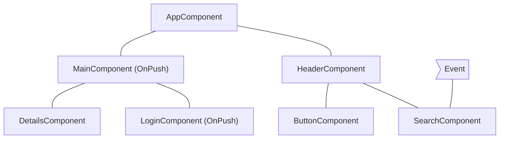
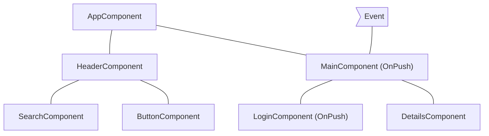
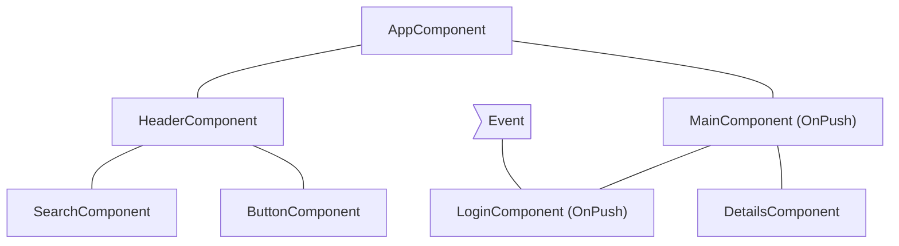
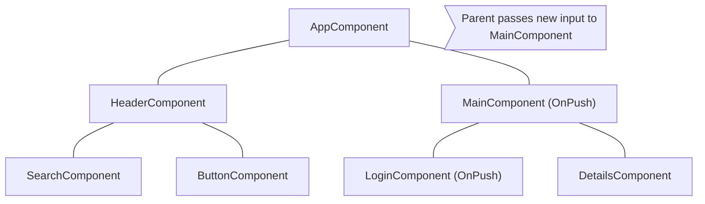

<!--
# Skipping component subtrees
-->

# 컴포넌트 하위 트리 건너뛰기

<!--
JavaScript, by default, uses mutable data structures that you can reference from multiple different components. Angular runs change detection over your entire component tree to make sure that the most up-to-date state of your data structures is reflected in the DOM.

Change detection is sufficiently fast for most applications. However, when an application has an especially large component tree, running change detection across the whole application can cause performance issues. You can address this by configuring change detection to only run on a subset of the component tree.
-->

JavaScript는 기본적으로 여러 컴포넌트에서 참조할 수 있는 가변 데이터 구조를 사용합니다.
Angular는 데이터 구조의 최신 상태가 DOM에 반영되도록 전체 컴포넌트 트리에서 변경 감지를 실행합니다.

대부분의 애플리케이션에서는 변경 감지 속도가 충분히 빠릅니다.
하지만 컴포넌트 트리가 특히 큰 애플리케이션에서 전체 변경 감지를 실행하면 성능 문제가 발생할 수 있습니다.
변경 감지가 컴포넌트 트리의 일부에서만 실행되도록 설정하면 이 문제에 대응할 수 있습니다.

<!--
## Using `OnPush`
-->

## `OnPush` 사용하기

<!--
OnPush is the default change detection strategy in Angular (since v22). It instructs Angular to run change detection for a component subtree **only** when:

- The root component of the subtree receives new inputs as the result of a template binding. Angular compares the current and past value of the input with `Object.is`.
- Angular handles an event _(for example using event binding, output binding, or `@HostListener` )_ in the subtree's root component or any of its children whether they are using OnPush change detection or not.
-->

Angular의 기본 변경 감지 전략은 OnPush입니다(v22부터).
이 전략에서는 다음 경우에**만** 컴포넌트 하위 트리의 변경 감지를 실행하도록 Angular에 지시합니다:

- 템플릿 바인딩의 결과로 하위 트리의 루트 컴포넌트가 새 입력값을 받는 경우입니다.
  Angular는 입력의 현재 값과 이전 값을 `Object.is`로 비교합니다.
- Angular가 하위 트리의 루트 컴포넌트나 자식 컴포넌트에서 _(이벤트 바인딩, 출력 바인딩, `@HostListener` 등을 통해)_ 이벤트를 처리하는 경우입니다.
  이때 자식 컴포넌트의 OnPush 변경 감지 사용 여부는 관계없습니다.

<!--
## Common change detection scenarios
-->

## 일반적인 변경 감지 사례

<!--
This section examines several common change detection scenarios to illustrate Angular's behavior.
-->

이 섹션에서는 여러 일반적인 변경 감지 사례를 통해 Angular의 동작을 살펴봅니다.

<!--
### An event is handled by a component with `Eager` change detection
-->

### `Eager` 변경 감지 컴포넌트에서 이벤트를 처리하는 경우

<!--
If Angular handles an event within a component with the `Eager` strategy, the framework executes change detection on the entire component tree. Angular will skip descendant component subtrees with roots using `OnPush`, which have not received new inputs.

As an example, if we set the change detection strategy of `MainComponent` to `OnPush` and the user interacts with a component outside the subtree with root `MainComponent`, Angular will check all the pink components from the diagram below (`AppComponent`, `HeaderComponent`, `SearchComponent`, `ButtonComponent`) unless `MainComponent` receives new inputs:

-->

Angular가 `Eager` 전략을 사용하는 컴포넌트에서 이벤트를 처리하면 전체 컴포넌트 트리에서 변경 감지를 실행합니다.
이때 루트가 `OnPush`를 사용하고 새 입력값을 받지 않은 하위 컴포넌트 트리는 건너뜁니다.

예를 들어 `MainComponent`의 변경 감지 전략을 `OnPush`로 설정한 뒤, 사용자가 `MainComponent`를 루트로 하는 하위 트리 바깥의 컴포넌트와 상호작용한다고 해 봅시다.
`MainComponent`가 새 입력값을 받지 않았다면 Angular는 다음 다이어그램의 분홍색 컴포넌트(`AppComponent`, `HeaderComponent`, `SearchComponent`, `ButtonComponent`)만 검사합니다:

<!--
## An event is handled by a component with OnPush
-->

## OnPush 컴포넌트에서 이벤트를 처리하는 경우

<!--
If Angular handles an event within a component with OnPush strategy, the framework will execute change detection within the entire component tree. Angular will ignore component subtrees with roots using OnPush, which have not received new inputs and are outside the component which handled the event.

As an example, if Angular handles an event within `MainComponent`, the framework will run change detection in the entire component tree. Angular will ignore the subtree with root `LoginComponent` because it has `OnPush` and the event happened outside of its scope.

-->

Angular가 OnPush 전략을 사용하는 컴포넌트에서 이벤트를 처리하면 전체 컴포넌트 트리에서 변경 감지를 실행합니다.
이벤트를 처리한 컴포넌트 바깥에 있고, 루트가 OnPush를 사용하며 새 입력값을 받지 않은 하위 컴포넌트 트리는 검사하지 않습니다.

예를 들어 Angular가 `MainComponent`에서 이벤트를 처리하면 전체 컴포넌트 트리에서 변경 감지를 실행합니다.
이때 `LoginComponent`는 `OnPush`를 사용하고 이벤트도 그 범위 바깥에서 발생했으므로, 이를 루트로 하는 하위 트리는 검사하지 않습니다.

<!--
## An event is handled by a descendant of a component with OnPush
-->

## OnPush 컴포넌트의 하위 컴포넌트에서 이벤트를 처리하는 경우

<!--
If Angular handles an event in a component with OnPush, the framework will execute change detection in the entire component tree, including the component’s ancestors.

As an example, in the diagram below, Angular handles an event in `LoginComponent` which uses OnPush. Angular will invoke change detection in the entire component subtree including `MainComponent` (`LoginComponent`’s parent), even though `MainComponent` has `OnPush` as well. Angular checks `MainComponent` as well because `LoginComponent` is part of its view.

-->

Angular가 OnPush 컴포넌트에서 이벤트를 처리하면 해당 컴포넌트의 상위 컴포넌트를 포함한 전체 컴포넌트 트리에서 변경 감지를 실행합니다.

예를 들어 다음 다이어그램에서는 OnPush를 사용하는 `LoginComponent`에서 Angular가 이벤트를 처리합니다.
`MainComponent`도 `OnPush`를 사용하지만, Angular는 `LoginComponent`의 부모인 `MainComponent`를 포함한 전체 컴포넌트 하위 트리에서 변경 감지를 실행합니다.
`LoginComponent`가 `MainComponent` 뷰의 일부이기 때문에 `MainComponent`도 검사하는 것입니다.

<!--
## New inputs to component with OnPush
-->

## OnPush 컴포넌트에 새 입력값을 전달하는 경우

<!--
Angular will run change detection within a child component with `OnPush` when setting an input property as result of a template binding.

For example, in the diagram below, `AppComponent` passes a new input to `MainComponent`, which has `OnPush`. Angular will run change detection in `MainComponent` but will not run change detection in `LoginComponent`, which also has `OnPush`, unless it receives new inputs as well.

-->

템플릿 바인딩의 결과로 입력 프로퍼티를 설정하면 Angular는 `OnPush` 자식 컴포넌트에서 변경 감지를 실행합니다.

예를 들어 다음 다이어그램에서는 `AppComponent`가 `OnPush`를 사용하는 `MainComponent`에 새 입력값을 전달합니다.
Angular는 `MainComponent`에서 변경 감지를 실행하지만, 역시 `OnPush`를 사용하는 `LoginComponent`는 새 입력값을 받지 않는 한 변경 감지를 실행하지 않습니다.

<!--
## Edge cases
-->

## 예외적인 경우

<!--
- **Modifying input properties in TypeScript code**. When you use an API like `@ViewChild` or `@ContentChild` to get a reference to a component in TypeScript and manually modify an `@Input` property, Angular will not automatically run change detection for OnPush components. If you need Angular to run change detection, you can inject `ChangeDetectorRef` in your component and call `changeDetectorRef.markForCheck()` to tell Angular to schedule a change detection.
- **Modifying object references**. In case an input receives a mutable object as value and you modify the object but preserve the reference, Angular will not invoke change detection. That’s the expected behavior because the previous and the current value of the input point to the same reference.
-->

- **TypeScript 코드에서 입력 프로퍼티를 수정하는 경우**.
  TypeScript에서 `@ViewChild`나 `@ContentChild` 같은 API로 컴포넌트 참조를 얻고 `@Input` 프로퍼티를 직접 수정하면 Angular는 OnPush 컴포넌트의 변경 감지를 자동으로 실행하지 않습니다.
  변경 감지가 필요하다면 컴포넌트에 `ChangeDetectorRef`를 주입하고 `changeDetectorRef.markForCheck()`를 호출해 Angular에 변경 감지를 예약하도록 알릴 수 있습니다.
- **객체 참조를 수정하는 경우**.
  입력값으로 가변 객체를 받고 참조는 유지한 채 객체를 수정하면 Angular는 변경 감지를 실행하지 않습니다.
  입력의 이전 값과 현재 값이 같은 참조를 가리키므로 이는 의도된 동작입니다.
