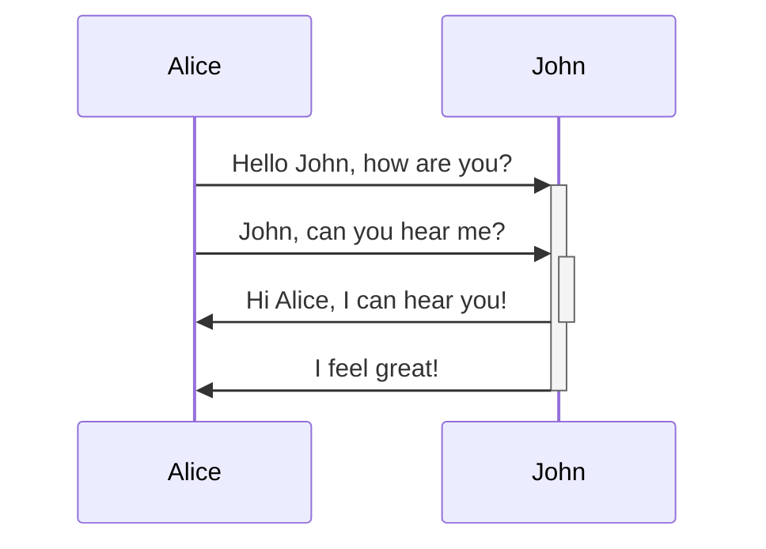
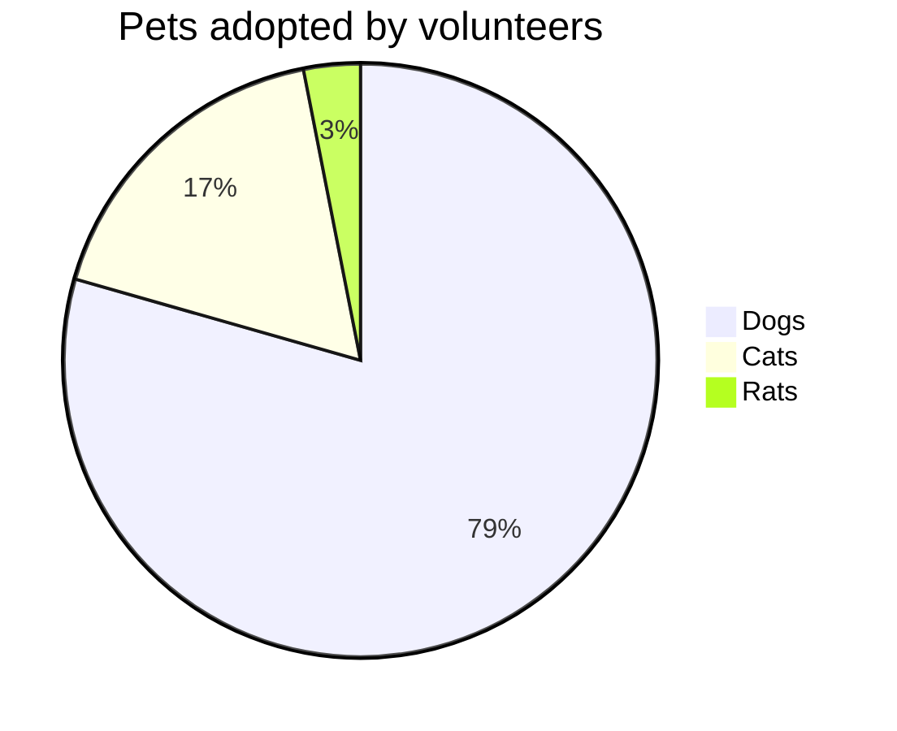
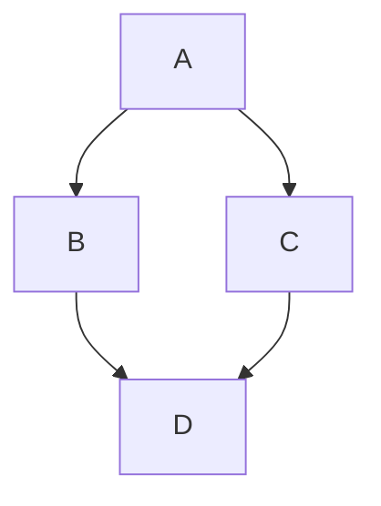
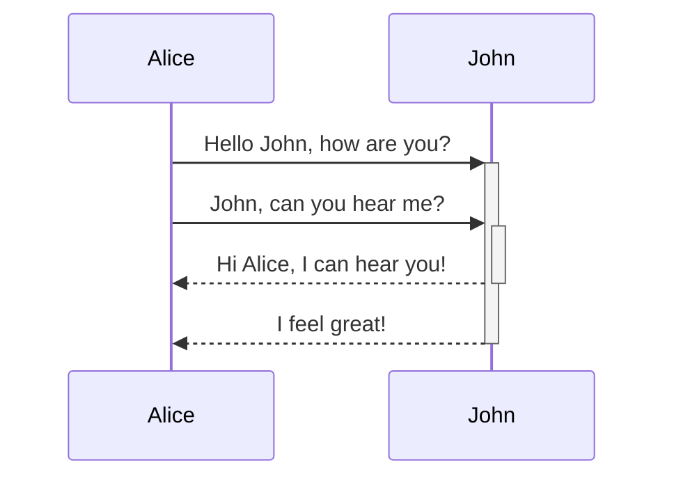

<!--
<docs-decorative-header title="Kitchen sink" imgSrc="adev/src/assets/images/components.svg"> <!- markdownlint-disable-line ->
This is a visual list of all custom components and styles for Angular.dev.
</docs-decorative-header>

As a design system, this page contains visual and Markdown authoring guidance for:

- Custom Angular docs elements: [`docs-card`](#cards), [`docs-callout`](#callouts), [`docs-pill`](#pills), and [`docs-steps`](#workflow)
- Custom text elements: [alerts](#alerts)
- Code examples: [`docs-code`](#code)
- Built-in Markdown styled elements: links, lists, [headers](#headers-h2), [horizontal lines](#horizontal-line-divider)
- and more!

Get ready to:

1. Write...
2. great...
3. docs!
-->

<docs-decorative-header title="구성 요소 모음" imgSrc="adev/src/assets/images/components.svg"> <!-- markdownlint-disable-line -->
Angular.dev의 모든 커스텀 컴포넌트와 스타일을 시각적으로 모아놓은 페이지입니다.
</docs-decorative-header>

이 페이지는 디자인 시스템으로서 다음 항목의 시각적 표현과 마크다운 작성 방법을 안내합니다:

- Angular 문서의 커스텀 요소: [`docs-card`](#cards), [`docs-callout`](#callouts), [`docs-pill`](#pills), [`docs-steps`](#workflow)
- 커스텀 텍스트 요소: [알림](#alerts)
- 코드 예제: [`docs-code`](#code)
- 기본 마크다운 스타일 요소: 링크, 목록, [제목](#headers-h2), [가로 구분선](#horizontal-line-divider)
- 그 외 다양한 요소!

이제 준비해 보세요:

1. 멋진...
2. 문서를...
3. 작성할 준비!

<!--
## Headers (h2)
-->

<a id="headers-h2"></a>

## 제목(h2)

<!--
### Smaller headers (h3)
-->

<a id="smaller-headers-h3"></a>

### 더 작은 제목(h3)

<!--
#### Even smaller (h4)
-->

<a id="even-smaller-h4"></a>

#### 한 단계 더 작은 제목(h4)

<!--
##### Even more smaller (h5)
-->

<a id="even-more-smaller-h5"></a>

##### 더 작은 제목(h5)

<!--
###### The smallest! (h6)
-->

<a id="the-smallest-h6"></a>

###### 가장 작은 제목!(h6)

<!--
## Cards
-->

<a id="cards"></a>

## 카드

<!--
<docs-card-container>
  <docs-card title="What is Angular?" link="Platform Overview" href="tutorials/first-app">
    Lorem ipsum dolor sit amet, consectetur adipiscing elit. Nullam ornare ligula nisi
  </docs-card>
  <docs-card title="Second Card" link="Try It Now" href="essentials/what-is-angular">
    Lorem ipsum dolor sit amet, consectetur adipiscing elit. Nullam ornare ligula nisi
  </docs-card>
    <docs-card title="No Link Card">
    Lorem ipsum dolor sit amet, consectetur adipiscing elit. Nullam ornare ligula nisi
  </docs-card>
</docs-card-container>
-->

<docs-card-container>
  <docs-card title="Angular란 무엇인가요?" link="플랫폼 개요" href="tutorials/first-app">
    Lorem ipsum dolor sit amet, consectetur adipiscing elit. Nullam ornare ligula nisi
  </docs-card>
  <docs-card title="두 번째 카드" link="지금 사용해 보기" href="essentials/what-is-angular">
    Lorem ipsum dolor sit amet, consectetur adipiscing elit. Nullam ornare ligula nisi
  </docs-card>
    <docs-card title="링크가 없는 카드">
    Lorem ipsum dolor sit amet, consectetur adipiscing elit. Nullam ornare ligula nisi
  </docs-card>
</docs-card-container>

<!--
### `<docs-card>` Attributes
-->

<a id="docs-card-attributes"></a>

### `<docs-card>` 어트리뷰트

<!--
| Attributes              | Details                                           |
| :---------------------- | :------------------------------------------------ |
| `<docs-card-container>` | All cards must be nested inside a container       |
| `title`                 | Card title                                        |
| card body contents      | Anything between `<docs-card>` and `</docs-card>` |
| `link`                  | (Optional) Call to Action link text               |
| `href`                  | (Optional) Call to Action link href               |
-->

| 어트리뷰트              | 설명                                                 |
| :---------------------- | :--------------------------------------------------- |
| `<docs-card-container>` | 모든 카드는 컨테이너 안에 중첩해야 합니다.           |
| `title`                 | 카드 제목                                            |
| 카드 본문 내용          | `<docs-card>`와 `</docs-card>` 사이에 있는 모든 내용 |
| `link`                  | (선택 사항) 행동을 유도하는 링크 텍스트              |
| `href`                  | (선택 사항) 행동을 유도하는 링크의 href              |

<!--
## Callouts
-->

<a id="callouts"></a>

## 안내 상자

<!--
<docs-callout title="Title of a callout that is helpful">
  Lorem ipsum dolor sit amet, consectetur adipiscing elit. Nulla luctus metus blandit semper faucibus. Sed blandit diam quis tellus maximus, ac scelerisque ex egestas. Ut euismod lobortis mauris pretium iaculis. Quisque ullamcorper, elit ut lacinia blandit, magna sem finibus urna, vel suscipit tortor dolor id risus.
</docs-callout>

<docs-callout critical title="Title of a callout that is critical">
  Lorem ipsum dolor sit amet, consectetur adipiscing elit. Nulla luctus metus blandit semper faucibus. Sed blandit diam quis tellus maximus, ac scelerisque ex egestas. Ut euismod lobortis mauris pretium iaculis. Quisque ullamcorper, elit ut lacinia blandit, magna sem finibus urna, vel suscipit tortor dolor id risus.
</docs-callout>

<docs-callout important title="Title of a callout that is important">
  Lorem ipsum dolor sit amet, consectetur adipiscing elit. Nulla luctus metus blandit semper faucibus. Sed blandit diam quis tellus maximus, ac scelerisque ex egestas. Ut euismod lobortis mauris pretium iaculis. Quisque ullamcorper, elit ut lacinia blandit, magna sem finibus urna, vel suscipit tortor dolor id risus.
</docs-callout>
-->

<docs-callout title="도움말 안내 상자의 제목">
  Lorem ipsum dolor sit amet, consectetur adipiscing elit. Nulla luctus metus blandit semper faucibus. Sed blandit diam quis tellus maximus, ac scelerisque ex egestas. Ut euismod lobortis mauris pretium iaculis. Quisque ullamcorper, elit ut lacinia blandit, magna sem finibus urna, vel suscipit tortor dolor id risus.
</docs-callout>

<docs-callout critical title="주의 안내 상자의 제목">
  Lorem ipsum dolor sit amet, consectetur adipiscing elit. Nulla luctus metus blandit semper faucibus. Sed blandit diam quis tellus maximus, ac scelerisque ex egestas. Ut euismod lobortis mauris pretium iaculis. Quisque ullamcorper, elit ut lacinia blandit, magna sem finibus urna, vel suscipit tortor dolor id risus.
</docs-callout>

<docs-callout important title="중요 안내 상자의 제목">
  Lorem ipsum dolor sit amet, consectetur adipiscing elit. Nulla luctus metus blandit semper faucibus. Sed blandit diam quis tellus maximus, ac scelerisque ex egestas. Ut euismod lobortis mauris pretium iaculis. Quisque ullamcorper, elit ut lacinia blandit, magna sem finibus urna, vel suscipit tortor dolor id risus.
</docs-callout>

<!--
### `<docs-callout>` Attributes
-->

<a id="docs-callout-attributes"></a>

### `<docs-callout>` 어트리뷰트

<!--
| Attributes                                       | Details                                                   |
| :----------------------------------------------- | :-------------------------------------------------------- |
| `title`                                          | Callout title                                             |
| card body contents                               | Anything between `<docs-callout>` and `</docs-callout>`   |
| `helpful` (default) \| `critical` \| `important` | (Optional) Adds styling and icons based on severity level |
-->

| 어트리뷰트                                      | 설명                                                       |
| :---------------------------------------------- | :--------------------------------------------------------- |
| `title`                                         | 안내 상자 제목                                             |
| 카드 본문 내용                                  | `<docs-callout>`과 `</docs-callout>` 사이에 있는 모든 내용 |
| `helpful` (기본값) \| `critical` \| `important` | (선택 사항) 중요도에 따라 스타일과 아이콘을 추가합니다.    |

<!--
## Pills
-->

<a id="pills"></a>

## 알약 모양 링크

<!--
Pill rows are helpful as a sort of navigation with links to helpful resources.

<docs-pill-row id=pill-row>
  <docs-pill href="#pill-row" title="Link"/>
  <docs-pill href="#pill-row" title="Link"/>
  <docs-pill href="#pill-row" title="Link"/>
  <docs-pill href="#pill-row" title="Link"/>
  <docs-pill href="#pill-row" title="Link"/>
  <docs-pill href="#pill-row" title="Link"/>
</docs-pill-row>
-->

알약 모양 링크 행은 유용한 리소스로 이동하는 내비게이션으로 사용할 수 있습니다.

<docs-pill-row id=pill-row>
  <docs-pill href="#pill-row" title="링크"/>
  <docs-pill href="#pill-row" title="링크"/>
  <docs-pill href="#pill-row" title="링크"/>
  <docs-pill href="#pill-row" title="링크"/>
  <docs-pill href="#pill-row" title="링크"/>
  <docs-pill href="#pill-row" title="링크"/>
</docs-pill-row>

<!--
### `<docs-pill>` Attributes
-->

<a id="docs-pill-attributes"></a>

### `<docs-pill>` 어트리뷰트

<!--
| Attributes       | Details                                    |
| :--------------- | :----------------------------------------- |
| `<docs-pill-row` | All pills must be nested inside a pill row |
| `title`          | Pill text                                  |
| `href`           | Pill href                                  |

Pills may also be used inline by themselves, but we haven't built that out yet.
-->

| 어트리뷰트       | 설명                                                |
| :--------------- | :-------------------------------------------------- |
| `<docs-pill-row` | 모든 알약 모양 링크는 링크 행 안에 중첩해야 합니다. |
| `title`          | 링크 텍스트                                         |
| `href`           | 링크의 href                                         |

알약 모양 링크는 인라인으로 단독 사용할 수도 있지만, 해당 기능은 아직 구현하지 않았습니다.

<!--
## Alerts
-->

<a id="alerts"></a>

## 알림

<!--
Alerts are just special paragraphs. They are helpful to call out (not to be confused with call-out) something that's a bit more urgent. They gain font size from context and are available in many levels. Try not to use alerts to render too much content, but rather to enhance and call attention to surrounding content.

Style alerts starting on a new line in Markdown using the format `SEVERITY_LEVEL` + `:` + `ALERT_TEXT`.

NOTE: Use Note for ancillary/additional information that's not _essential_ to the main text.

TIP: Use Tip to call out a specific task/action users can perform, or a fact that plays directly into a task/action.

TODO: Use TODO for incomplete documentation that you plan to expand soon. You can also assign the TODO, e.g. TODO(emmatwersky): Text.

QUESTION: Use Question to pose a question to the reader, kind of like a mini-quiz that they should be able to answer.

SUMMARY: Use Summary to provide a two- or three-sentence synopsis of the page or section content, so readers can figure out whether this is the right place for them.

TLDR: Use TL;DR (or TLDR) if you can provide the essential information about a page or section in a sentence or two. For example, TLDR: Rhubarb is a cat.

CRITICAL: Use Critical to call out potential bad stuff or alert the reader they ought to be careful before doing something. For example, Warning: Running `rm` with the `-f` option will delete write-protected files or directories without prompting you.

IMPORTANT: Use Important for information that's crucial to comprehending the text or to completing some task.

HELPFUL: Use Best practice to call out practices that are known to be successful or better than alternatives.

NOTE: Heads up `developers`! Alerts _can_ have a [link](#alerts) and other nested styles (but try to **use this sparingly**)!.
-->

알림은 특별한 형태의 문단입니다.
조금 더 시급한 내용을 강조할 때 유용하며, 안내 상자(callout)와는 다릅니다.
글꼴 크기는 주변 맥락에 따라 정해지고 여러 수준으로 사용할 수 있습니다.
너무 많은 콘텐츠를 알림으로 표시하기보다는 주변 콘텐츠를 보완하고 주의를 끄는 용도로 사용하세요.

마크다운의 새 줄에서 `SEVERITY_LEVEL` + `:` + `ALERT_TEXT` 형식으로 알림 스타일을 적용할 수 있습니다.

참고: 본문에 _필수적이지 않은_ 부가 정보나 추가 정보에는 Note를 사용하세요.

팁: 사용자가 수행할 수 있는 구체적인 작업이나 행동, 또는 그 작업이나 행동에 직접 관련된 사실을 강조할 때 Tip을 사용하세요.

할 일: 곧 보완할 예정인 미완성 문서에는 TODO를 사용하세요.
TODO(emmatwersky): 내용과 같이 담당자를 지정할 수도 있습니다.

질문: 독자에게 답할 수 있을 만한 짧은 퀴즈 형태로 질문할 때 Question을 사용하세요.

요약: 독자가 원하는 내용인지 판단할 수 있도록 페이지나 섹션의 내용을 두세 문장으로 요약할 때 Summary를 사용하세요.

짧은 요약: 페이지나 섹션의 핵심 정보를 한두 문장으로 전달할 수 있다면 TL;DR(또는 TLDR)을 사용하세요.
예를 들어 TLDR: Rhubarb는 고양이입니다.

주의: 발생할 수 있는 문제를 강조하거나 어떤 작업을 하기 전에 주의해야 한다고 알릴 때 Critical을 사용하세요.
예를 들어 Warning: `rm`을 `-f` 옵션과 함께 실행하면 확인을 요청하지 않고 쓰기 금지된 파일이나 디렉터리를 삭제합니다.

중요: 글을 이해하거나 특정 작업을 완료하는 데 꼭 필요한 정보에는 Important를 사용하세요.

도움말: 성공적인 것으로 알려져 있거나 다른 방법보다 나은 방식을 강조할 때 Best practice를 사용하세요.

참고: `개발자` 여러분, 알림에도 [링크](#alerts)와 다른 중첩 스타일을 사용할 _수 있습니다_ (다만 **꼭 필요한 곳에만 사용하세요**)!

<!--
## Code
-->

<a id="code"></a>

## 코드

<!--
You can display `code` using the built in triple backtick:

```ts
example code
```

Or using the `<docs-code>` element.

<docs-code header="Your first example" language="ts" linenums>
import { Component } from '@angular/core';

@Component({
selector: 'example-code',
template: '<h1>Hello World!</h1>',
})
export class ComponentOverviewComponent {}
</docs-code>
-->

기본 문법인 백틱 세 개로 `코드`를 표시할 수 있습니다:

```ts
example code
```

또는 `<docs-code>` 요소를 사용하면 됩니다.

<docs-code header="첫 번째 예제" language="ts" linenums>
import { Component } from '@angular/core';

@Component({
selector: 'example-code',
template: '<h1>Hello World!</h1>',
})
export class ComponentOverviewComponent {}
</docs-code>

<!--
### Styling the example
-->

<a id="styling-the-example"></a>

### 예제 스타일 지정하기

<!--
Here's a code example fully styled:

<docs-code
  path="adev/src/content/examples/hello-world/src/app/app.component-old.ts"
  header="A styled code example"
  language='ts'
  linenums
  highlight="[[3,7], 9]"
  preview
  visibleLines="[3,10]">
</docs-code>

We also have styling for the terminal, just set the language as `shell`:

```shell
npm install @angular/material --save
```

You can style standard Markdown triple backticks with attributes for enhanced presentation:

```ts {header:"Awesome Title", linenums, highlight: [2], hideCopy}
console.log('Hello, World!');
console.log('Awesome Angular Docs!');
```
-->

다음은 스타일을 모두 적용한 코드 예제입니다:

<docs-code
  path="adev/src/content/examples/hello-world/src/app/app.component-old.ts"
  header="스타일을 적용한 코드 예제"
  language='ts'
  linenums
  highlight="[[3,7], 9]"
  preview
  visibleLines="[3,10]">
</docs-code>

터미널용 스타일도 지원합니다.
언어를 `shell`로 설정하면 됩니다:

```shell
npm install @angular/material --save
```

기본 마크다운의 백틱 세 개에 어트리뷰트를 지정하면 더 풍부한 스타일로 표시할 수 있습니다:

```ts {header:"멋진 제목", linenums, highlight: [2], hideCopy}
console.log('Hello, World!');
console.log('Awesome Angular Docs!');
```

<!--
#### `<docs-code>` Attributes
-->

<a id="docs-code-attributes"></a>

#### `<docs-code>` 어트리뷰트

<!--
| Attributes     | Type                 | Details                                                         |
| :------------- | :------------------- | :-------------------------------------------------------------- |
| code           | `string`             | Anything between tags is treated as code                        |
| `path`         | `string`             | Path to code example (root: `content/examples/`)                |
| `header`       | `string`             | Title of the example (default: `file-name`)                     |
| `language`     | `string`             | code language                                                   |
| `linenums`     | `boolean`            | (False) displays line numbers                                   |
| `highlight`    | `string of number[]` | lines highlighted                                               |
| `diff`         | `string`             | path to changed code                                            |
| `visibleLines` | `string of number[]` | range of lines for collapse mode                                |
| `region`       | `string`             | only show the provided region.                                  |
| `preview`      | `boolean`            | (False) display preview                                         |
| `hideCode`     | `boolean`            | (False) Whether to collapse code example by default.            |
| `hideDollar`   | `boolean`            | (False) Whether to hide the dollar sign in shell code examples. |
-->

| 어트리뷰트     | 타입                 | 설명                                                           |
| :------------- | :------------------- | :------------------------------------------------------------- |
| 코드           | `string`             | 태그 사이의 모든 내용은 코드로 처리합니다.                     |
| `path`         | `string`             | 코드 예제 경로(루트: `content/examples/`)                      |
| `header`       | `string`             | 예제 제목(기본값: `file-name`)                                 |
| `language`     | `string`             | 코드 언어                                                      |
| `linenums`     | `boolean`            | (기본값 False) 줄 번호를 표시합니다.                           |
| `highlight`    | `string of number[]` | 강조할 줄                                                      |
| `diff`         | `string`             | 변경한 코드의 경로                                             |
| `visibleLines` | `string of number[]` | 접기 모드에서 표시할 줄 범위                                   |
| `region`       | `string`             | 지정한 영역만 표시합니다.                                      |
| `preview`      | `boolean`            | (기본값 False) 미리보기를 표시합니다.                          |
| `hideCode`     | `boolean`            | (기본값 False) 코드 예제를 기본적으로 접을지 여부입니다.       |
| `hideDollar`   | `boolean`            | (기본값 False) 셸 코드 예제에서 달러 기호를 숨길지 여부입니다. |

<!--
### Multifile examples
-->

<a id="multifile-examples"></a>

### 여러 파일로 구성된 예제

<!--
You can create multifile examples by wrapping the examples inside a `<docs-code-multifile>`.

<docs-code-multifile
  path="adev/src/content/examples/hello-world/src/app/app.component.ts"
  preview>
<docs-code
    path="adev/src/content/examples/hello-world/src/app/app.component.html"
    highlight="[1]"
    linenums/>
<docs-code
    path="adev/src/content/examples/hello-world/src/app/app.component.css" />
</docs-code-multifile>
-->

여러 예제를 `<docs-code-multifile>`로 감싸면 여러 파일로 구성된 예제를 만들 수 있습니다.

<docs-code-multifile
  path="adev/src/content/examples/hello-world/src/app/app.component.ts"
  preview>
<docs-code
    path="adev/src/content/examples/hello-world/src/app/app.component.html"
    highlight="[1]"
    linenums/>
<docs-code
    path="adev/src/content/examples/hello-world/src/app/app.component.css" />
</docs-code-multifile>

<!--
#### `<docs-code-multifile>` Attributes
-->

<a id="docs-code-multifile-attributes"></a>

#### `<docs-code-multifile>` 어트리뷰트

<!--
| Attributes    | Type      | Details                                                         |
| :------------ | :-------- | :-------------------------------------------------------------- |
| body contents | `string`  | nested tabs of `docs-code` examples                             |
| `path`        | `string`  | Path to code example for preview and external link              |
| `preview`     | `boolean` | (False) display preview                                         |
| `hideCode`    | `boolean` | (False) Whether to collapse code example by default.            |
| `hideDollar`  | `boolean` | (False) Whether to hide the dollar sign in shell code examples. |
-->

| 어트리뷰트   | 타입      | 설명                                                           |
| :----------- | :-------- | :------------------------------------------------------------- |
| 본문 내용    | `string`  | 중첩된 `docs-code` 예제 탭                                     |
| `path`       | `string`  | 미리보기와 외부 링크에 사용할 코드 예제 경로                   |
| `preview`    | `boolean` | (기본값 False) 미리보기를 표시합니다.                          |
| `hideCode`   | `boolean` | (기본값 False) 코드 예제를 기본적으로 접을지 여부입니다.       |
| `hideDollar` | `boolean` | (기본값 False) 셸 코드 예제에서 달러 기호를 숨길지 여부입니다. |

<!--
### Adding `preview` to your code example
-->

<a id="adding-preview-to-your-code-example"></a>

### 코드 예제에 `preview` 추가하기

<!--
Adding the `preview` flag builds a running example of the code below the code snippet. This also automatically adds a button to open the running example in StackBlitz.

NOTE: `preview` only works with standalone.
-->

`preview` 플래그를 추가하면 코드 아래에 실제로 실행되는 예제를 만듭니다.
실행 중인 예제를 StackBlitz에서 열 수 있는 버튼도 자동으로 추가합니다.

참고: `preview`는 독립형 컴포넌트에서만 동작합니다.

<!--
### Styling example previews with Tailwind CSS
-->

<a id="styling-example-previews-with-tailwind-css"></a>

### Tailwind CSS로 예제 미리보기 스타일 지정하기

<!--
Tailwind utility classes can be used within code examples.

<docs-code-multifile
  path="adev/src/content/examples/hello-world/src/app/tailwind-app.component.ts"
  preview>
<docs-code path="adev/src/content/examples/hello-world/src/app/tailwind-app.component.html" />
<docs-code path="adev/src/content/examples/hello-world/src/app/tailwind-app.component.ts" />
</docs-code-multifile>
-->

코드 예제 안에서 Tailwind 유틸리티 클래스를 사용할 수 있습니다.

<docs-code-multifile
  path="adev/src/content/examples/hello-world/src/app/tailwind-app.component.ts"
  preview>
<docs-code path="adev/src/content/examples/hello-world/src/app/tailwind-app.component.html" />
<docs-code path="adev/src/content/examples/hello-world/src/app/tailwind-app.component.ts" />
</docs-code-multifile>

<!--
## Tabs
-->

<a id="tabs"></a>

## 탭

<!--
<docs-tab-group>
  <docs-tab label="Code Example">
    <docs-code-multifile
      path="adev/src/content/examples/hello-world/src/app/tailwind-app.component.ts"
      hideCode="true"
      preview>
    <docs-code path="adev/src/content/examples/hello-world/src/app/tailwind-app.component.html" />
    <docs-code path="adev/src/content/examples/hello-world/src/app/tailwind-app.component.ts" />
    </docs-code-multifile>
  </docs-tab>
  <docs-tab label="Some Text">
    Lorem ipsum dolor sit amet, consectetur adipiscing elit. Nulla luctus metus blandit semper faucibus. Sed blandit diam quis tellus maximus, ac scelerisque ex egestas. Ut euismod lobortis mauris pretium iaculis. Quisque ullamcorper, elit ut lacinia blandit, magna sem finibus urna, vel suscipit tortor dolor id risus.
  </docs-tab>
</docs-tab-group>
-->

<docs-tab-group>
  <docs-tab label="코드 예제">
    <docs-code-multifile
      path="adev/src/content/examples/hello-world/src/app/tailwind-app.component.ts"
      hideCode="true"
      preview>
    <docs-code path="adev/src/content/examples/hello-world/src/app/tailwind-app.component.html" />
    <docs-code path="adev/src/content/examples/hello-world/src/app/tailwind-app.component.ts" />
    </docs-code-multifile>
  </docs-tab>
  <docs-tab label="텍스트">
    Lorem ipsum dolor sit amet, consectetur adipiscing elit. Nulla luctus metus blandit semper faucibus. Sed blandit diam quis tellus maximus, ac scelerisque ex egestas. Ut euismod lobortis mauris pretium iaculis. Quisque ullamcorper, elit ut lacinia blandit, magna sem finibus urna, vel suscipit tortor dolor id risus.
  </docs-tab>
</docs-tab-group>

<!--
## Workflow
-->

<a id="workflow"></a>

## 작업 흐름

<!--
Style numbered steps using `<docs-step>`. Numbering is created using CSS (handy!).
-->

번호가 매겨진 단계 스타일을 지정하려면 `<docs-step>`을 사용하세요.
번호는 CSS가 자동으로 생성하므로 편리합니다.

<!--
### `<docs-workflow>` and `<docs-step>` Attributes
-->

<a id="docs-workflow-and-docs-step-attributes"></a>

### `<docs-workflow>`와 `<docs-step>` 어트리뷰트

<!--
| Attributes         | Details                                           |
| :----------------- | :------------------------------------------------ |
| `<docs-workflow>`  | All steps must be nested inside a workflow        |
| `title`            | Step title                                        |
| step body contents | Anything between `<docs-step>` and `</docs-step>` |

Steps must start on a new line, and can contain `docs-code`s and other nested elements and styles.

<docs-workflow>

<docs-step title="Install the Angular CLI">
  You use the Angular CLI to create projects, generate application and library code, and perform a variety of ongoing development tasks such as testing, bundling, and deployment.

To install the Angular CLI, open a terminal window and run the following command:

```shell
npm install -g @angular/cli
```

</docs-step>

<docs-step title="Create a workspace and initial application">
  You develop apps in the context of an Angular workspace.

To create a new workspace and initial starter app:

- Run the CLI command `ng new` and provide the name `my-app`, as shown here:

  ```shell
  ng new my-app
  ```

- The ng new command prompts you for information about features to include in the initial app. Accept the defaults by pressing the Enter or Return key.

  The Angular CLI installs the necessary Angular npm packages and other dependencies. This can take a few minutes.

  The CLI creates a new workspace and a simple Welcome app, ready to run.
  </docs-step>

<docs-step title="Run the application">
  The Angular CLI includes a server, for you to build and serve your app locally.

1. Navigate to the workspace folder, such as `my-app`.
2. Run the following command:

   ```shell
   cd my-app
   ng serve --open
   ```

The `ng serve` command launches the server, watches your files, and rebuilds the app as you make changes to those files.

The `--open` (or just `-o`) option automatically opens your browser to <http://localhost:4200/>.
If your installation and setup was successful, you should see a page similar to the following.
</docs-step>

<docs-step title="Final step">
  That's all the docs components! Now:

  <docs-pill-row>
    <docs-pill href="#pill-row" title="Go"/>
    <docs-pill href="#pill-row" title="write"/>
    <docs-pill href="#pill-row" title="great"/>
    <docs-pill href="#pill-row" title="docs!"/>
  </docs-pill-row>
</docs-step>

</docs-workflow>
-->

| 어트리뷰트        | 설명                                                 |
| :---------------- | :--------------------------------------------------- |
| `<docs-workflow>` | 모든 단계는 작업 흐름 안에 중첩해야 합니다.          |
| `title`           | 단계 제목                                            |
| 단계 본문 내용    | `<docs-step>`과 `</docs-step>` 사이에 있는 모든 내용 |

각 단계는 새 줄에서 시작해야 하며, `docs-code`와 다른 중첩 요소 및 스타일을 포함할 수 있습니다.

<docs-workflow>

<a id="install-the-angular-cli"></a>

<docs-step title="Angular CLI 설치하기">
  Angular CLI로 프로젝트를 만들고, 애플리케이션과 라이브러리 코드를 생성하고, 테스트, 번들링, 배포 등 개발 과정의 다양한 작업을 수행합니다.

Angular CLI를 설치하려면 터미널 창을 열고 다음 명령을 실행하세요:

```shell
npm install -g @angular/cli
```

</docs-step>

<a id="create-a-workspace-and-initial-application"></a>

<docs-step title="작업 공간과 초기 애플리케이션 만들기">
  앱은 Angular 작업 공간 안에서 개발합니다.

새 작업 공간과 초기 앱을 만들려면 다음과 같이 하세요:

- 다음과 같이 CLI의 `ng new` 명령을 실행하면서 `my-app`이라는 이름을 지정하세요:

  ```shell
  ng new my-app
  ```

- ng new 명령은 초기 앱에 포함할 기능에 관한 정보를 묻습니다.
  Enter 또는 Return 키를 눌러 기본값을 선택하세요.

  Angular CLI가 필요한 Angular npm 패키지와 다른 의존성을 설치합니다.
  이 과정에는 몇 분이 걸릴 수 있습니다.

  CLI는 새 작업 공간과 바로 실행할 수 있는 간단한 환영 앱을 만듭니다.
  </docs-step>

<a id="run-the-application"></a>

<docs-step title="애플리케이션 실행하기">
  Angular CLI에는 로컬에서 앱을 빌드하고 제공하는 서버가 포함되어 있습니다.

1. `my-app`과 같은 작업 공간 폴더로 이동하세요.
2. 다음 명령을 실행하세요:

   ```shell
   cd my-app
   ng serve --open
   ```

`ng serve` 명령은 서버를 시작하고 파일을 감시하며, 파일을 변경하면 앱을 다시 빌드합니다.

`--open`(또는 `-o`) 옵션을 사용하면 브라우저에서 <http://localhost:4200/>을 자동으로 엽니다.
설치와 설정이 성공했다면 다음과 비슷한 페이지가 표시됩니다.
</docs-step>

<a id="final-step"></a>

<docs-step title="마지막 단계">
  문서 컴포넌트를 모두 살펴봤습니다!
  이제:

  <docs-pill-row>
    <docs-pill href="#pill-row" title="멋진"/>
    <docs-pill href="#pill-row" title="문서를"/>
    <docs-pill href="#pill-row" title="직접"/>
    <docs-pill href="#pill-row" title="작성해 보세요!"/>
  </docs-pill-row>
</docs-step>

</docs-workflow>

<!--
## Images and video
-->

<a id="images-and-video"></a>

## 이미지와 동영상

<!--
You can add images using the semantic Markdown image:


-->

의미를 나타내는 마크다운 이미지 문법으로 이미지를 추가할 수 있습니다:


<!--
### Add `#small` and `#medium` to change the image size
-->

<a id="add-small-and-medium-to-change-the-image-size"></a>

### `#small`과 `#medium`으로 이미지 크기 변경하기

<!--


-->


<!--
## Add attributes using curly braces syntax
-->

<a id="add-attributes-using-curly-braces-syntax"></a>

## 중괄호 문법으로 어트리뷰트 추가하기

<!--


Embedded videos are created with `docs-video` and just need a `src` and `title`:

<docs-video src="https://www.youtube.com/embed/O47uUnJjbJc" title="Expression changed after checked"/>
-->


동영상을 삽입할 때는 `docs-video`에 `src`와 `title`만 지정하면 됩니다:

<docs-video src="https://www.youtube.com/embed/O47uUnJjbJc" title="Expression changed after checked"/>

<!--
## Charts & Graphs
-->

<a id="charts-graphs"></a>

<a id="charts--graphs"></a>

## 차트와 그래프

<!--
Write diagrams and charts using [Mermaid](https://mermaid.js.org/) by setting the code language to `mermaid`, all theming is built-in.

```mermaid
    graph TD;
      A->B;
      A->C;
      B->D;
      C->D;
```




-->

코드 언어를 `mermaid`로 설정하면 [Mermaid](https://mermaid.js.org/)로 다이어그램과 차트를 작성할 수 있습니다.
테마는 모두 기본 제공됩니다.






<!--
## Horizontal Line Divider
-->

<a id="horizontal-line-divider"></a>

## 가로 구분선

<!--
This can be used to separate page sections, like we're about to do below. These styles will be added by default, nothing custom needed.

<hr/>

The end!
-->

다음 예제처럼 페이지의 섹션을 구분하는 데 사용할 수 있습니다.
스타일은 기본적으로 적용되므로 별도의 설정이 필요하지 않습니다.

<hr/>

끝!

<!--
## Prefer / Avoid
-->

<a id="prefer-avoid"></a>

<a id="prefer---avoid"></a>

## 권장하는 방식 / 피해야 할 방식

<!--
```ts {prefer}
const foo = 'bar';
```

```ts {avoid}
const bar = 'foo';
```

```ts {avoid, header: 'with a header'}
const baz = 42;
```

<docs-code
  path="adev/src/content/examples/hello-world/src/app/app.component-old.ts"
  header="A styled code example"
  language='ts'
  linenums
  highlight="[[3,7], 9]"
  prefer>
</docs-code>
-->

```ts {prefer}
const foo = 'bar';
```

```ts {avoid}
const bar = 'foo';
```

```ts {avoid, header: '제목이 있는 예제'}
const baz = 42;
```

<docs-code
  path="adev/src/content/examples/hello-world/src/app/app.component-old.ts"
  header="스타일을 적용한 코드 예제"
  language='ts'
  linenums
  highlight="[[3,7], 9]"
  prefer>
</docs-code>
